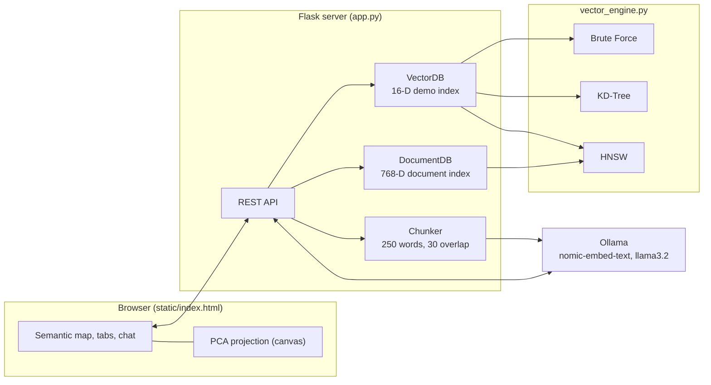
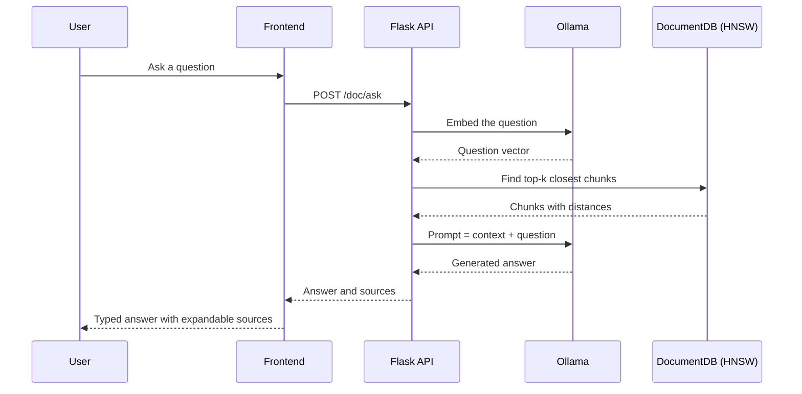

<div align="center">

# VectorDB Studio

**A from-scratch vector database with three search algorithms, an interactive semantic map, and a local, private RAG assistant.**

[](https://www.python.org/)
[](https://flask.palletsprojects.com/)
[](https://ollama.com/)
[](#tech-stack)
[](#license)

[Overview](#overview) · [Screenshots](#screenshots) · [Features](#features) · [Architecture](#architecture) · [Getting Started](#getting-started) · [API Reference](#api-reference) · [Deployment](#deployment) · [Author](#author)

</div>

---

## Overview

**VectorDB Studio** is a full-stack vector database and retrieval-augmented generation (RAG) application. It implements the core of how modern semantic search works, with no external vector database library, and wraps it in a clean web interface so you can see what the algorithms are doing.

The project has two parts that work together:

1. **A vector search engine** with three nearest-neighbor algorithms (Brute Force, KD-Tree and HNSW) and three distance metrics (cosine, Euclidean, Manhattan). Search results are plotted on a live 2D map using PCA, so you can see why a query matched what it matched.
2. **A document question-answering pipeline.** You paste your own text, it is split into overlapping chunks and embedded locally with Ollama, and an HNSW index retrieves the most relevant passages. A local LLM then answers using only that context. Nothing leaves your machine.

### Why this project exists

Vector databases power search, recommendations and RAG, but they are usually used as black boxes. This project builds the data structures directly, so every part is readable: how HNSW builds its layered graph, how a KD-Tree prunes branches, how benchmark times differ, and how retrieved chunks turn into a grounded answer.

### What it demonstrates

| Area | Skills shown |
|---|---|
| Algorithms and data structures | HNSW (layered proximity graph), KD-Tree, heap-based k-NN, PCA by power iteration |
| Backend engineering | REST API design with Flask, thread-safe in-memory stores, clean module boundaries |
| Applied AI | Embeddings, chunking with overlap, similarity thresholds, retrieval-augmented generation |
| Frontend | Canvas rendering, responsive UI, theming, async API integration with no framework |
| Systems | Local LLM integration over HTTP, graceful degradation when Ollama is offline |

---

## Features

### Vector search engine
- **Three search algorithms**, switchable at query time:
  - **Brute Force**: exact, compares against every vector
  - **KD-Tree**: exact, prunes branches using the splitting axis
  - **HNSW**: approximate, searches a multi-layer proximity graph (`M=16`, `efConstruction=200`, `efSearch=50`)
- **Three distance metrics**: Cosine, Euclidean, Manhattan
- **Live insert and delete** with all three indexes kept in sync
- **One-click benchmark** that times all three algorithms on your query
- **HNSW inspector** showing node and edge counts per layer

### Visualization
- **Semantic map**: 2D PCA projection of the vectors, computed in the browser, with hover tooltips, highlighted hits and a query marker
- **Query vector chart** showing all 16 dimensions grouped by category
- **Light and dark themes** *(available in the redesigned UI)*

### Document Q&A (RAG)
- **Automatic chunking**: 250-word chunks with 30 words of overlap
- **Real embeddings** from Ollama's `nomic-embed-text` (768 dimensions)
- **Smart retrieval**: exact search for small collections, HNSW for larger ones, with a cosine-distance cutoff of 0.7 to drop weak matches
- **Local answer generation** with `llama3.2`, grounded in the retrieved passages
- **Source transparency**: every answer lists the passages it used, with distances
- **Works offline and stays private**: no cloud API, no API keys

### Engineering details
- Thread-safe stores using re-entrant locks
- Same REST API shape as the original C++ implementation
- CORS enabled so the frontend can be hosted separately
- Graceful errors when Ollama is not running

---

## Architecture



### RAG request flow



### Project structure

```
VectorDB-Studio/
├── app.py                # Flask app: REST routes and static file server
├── vector_engine.py      # Distance metrics, Brute Force, KD-Tree, HNSW
├── database.py           # VectorDB, DocumentDB, text chunker, demo dataset
├── ollama_client.py      # HTTP client for Ollama (embeddings and generation)
├── requirements.txt      # Python dependencies
├── static/
│   └── index.html        # Complete frontend (HTML, CSS, JavaScript)
├── docs/
│   └── screenshots/      # Images used in this README
└── README.md
```

| Module | Responsibility |
|---|---|
| `vector_engine.py` | Pure algorithm code. No web or database logic. |
| `database.py` | Stores and coordinates the indexes, chunking, and the 20 demo vectors. |
| `ollama_client.py` | Everything that talks to Ollama, so it can be swapped for another provider. |
| `app.py` | Request parsing, validation, JSON responses, and serving the UI. |

---

## Tech stack

| Layer | Technology |
|---|---|
| Backend | Python 3.9+, Flask |
| Search algorithms | Custom implementations (Brute Force, KD-Tree, HNSW) |
| HTTP client | `requests` |
| Embeddings | Ollama with `nomic-embed-text` (768-D) |
| Language model | Ollama with `llama3.2` |
| Frontend | HTML5, CSS3, vanilla JavaScript, Canvas API |
| Dimensionality reduction | PCA via power iteration (in the browser) |

---

## Getting started

### Prerequisites

| Requirement | Needed for | Notes |
|---|---|---|
| Python 3.9 or newer | Everything | [python.org/downloads](https://www.python.org/downloads/) |
| Git | Cloning the repo | [git-scm.com](https://git-scm.com/) |
| Ollama | Documents and Ask AI tabs | [ollama.com](https://ollama.com/). The Search tab works without it. |
| About 4 GB free RAM | Running the local models | Mostly for `llama3.2` |

### 1. Clone the repository

```bash
git clone https://github.com/AayushPanchal-04/VectorDB-Studio.git
cd VectorDB-Studio
```

> If the project files are inside a subfolder in your copy, `cd` into the folder that contains `app.py`.

### 2. Create a virtual environment (recommended)

**Windows (PowerShell)**
```powershell
python -m venv venv
venv\Scripts\Activate.ps1
```

**macOS / Linux**
```bash
python3 -m venv venv
source venv/bin/activate
```

### 3. Install dependencies

```bash
pip install -r requirements.txt
```

### 4. Set up Ollama (for Documents and Ask AI)

Install Ollama from [ollama.com](https://ollama.com/), then download the two models once:

```bash
ollama pull nomic-embed-text
ollama pull llama3.2
```

Check that both are installed:

```bash
ollama list
```

On Windows and macOS, Ollama usually starts in the background after installation. If you get a connection error, start it manually in a separate terminal and leave that terminal open:

```bash
ollama serve
```

### 5. Run the application

```bash
python app.py
```

You should see:

```
=== VectorDB Engine (Python) ===
http://localhost:8080
20 demo vectors | 16 dims | HNSW+KD-Tree+BruteForce
Ollama: ONLINE
  embed model: nomic-embed-text  gen model: llama3.2
```

Open **http://localhost:8080** in your browser.

If `python` is not recognized, use `python3` (macOS and Linux) or `py` (Windows).

### Quick command reference

| Task | Command |
|---|---|
| Install dependencies | `pip install -r requirements.txt` |
| Start the app | `python app.py` |
| Download embedding model | `ollama pull nomic-embed-text` |
| Download language model | `ollama pull llama3.2` |
| List installed models | `ollama list` |
| Start Ollama manually | `ollama serve` |
| Stop the app | `Ctrl + C` in the terminal |

---

## How to use

### 1. Search (demo vectors)
1. Type a topic such as `binary tree`, `sushi` or `basketball`.
2. Choose an algorithm (HNSW, KD-Tree or Brute Force) and a distance metric.
3. Set how many results to return, then select **Search**.
4. Read the matches, latency, and query vector, and watch the star move on the map.
5. Select **Compare All Algorithms** to benchmark the three methods side by side.

### 2. Documents
1. Open the **Documents** tab and confirm Ollama shows as online.
2. Enter a title and paste your text.
3. Select **Embed & Insert**. Long text is split into overlapping chunks automatically.

### 3. Ask AI
1. Open the **Ask AI** tab and type a question about your documents.
2. Choose how many source chunks to retrieve (Top 2, 3 or 5).
3. Read the answer and select a source chip to see the passage it came from.

**Try these sample documents:** Dynamic Programming, Binary Search Tree, HNSW Vector Search, Machine Learning, Neural Networks and RAG. Then ask *"What is dynamic programming?"* or *"How does HNSW search work?"*

---

## API reference

Base URL: `http://localhost:8080`. All responses are JSON.

### Vector endpoints

| Method | Endpoint | Description |
|---|---|---|
| `GET` | `/search` | k-nearest-neighbor search |
| `POST` | `/insert` | Add a vector |
| `DELETE` | `/delete/<id>` | Remove a vector |
| `GET` | `/items` | List all vectors |
| `GET` | `/benchmark` | Time all three algorithms |
| `GET` | `/hnsw-info` | HNSW layer and graph statistics |
| `GET` | `/stats` | Database summary |

**`GET /search`**

| Parameter | Type | Default | Description |
|---|---|---|---|
| `v` | comma-separated floats | required | Query vector, exactly 16 values |
| `k` | integer | `5` | Number of results |
| `metric` | `cosine` / `euclidean` / `manhattan` | `cosine` | Distance metric |
| `algo` | `hnsw` / `kdtree` / `bruteforce` | `hnsw` | Search algorithm |

```bash
curl "http://localhost:8080/search?v=0.9,0.85,0.72,0.68,0.12,0.08,0.15,0.10,0.05,0.08,0.06,0.09,0.07,0.11,0.08,0.06&k=3&metric=cosine&algo=hnsw"
```

```json
{
  "algo": "hnsw",
  "metric": "cosine",
  "latencyUs": 88,
  "results": [
    {
      "id": 1,
      "metadata": "Linked List: nodes connected by pointers",
      "category": "cs",
      "distance": 0.0,
      "embedding": [0.9, 0.85, 0.72, "..."]
    }
  ]
}
```

**`POST /insert`**

```bash
curl -X POST http://localhost:8080/insert \
  -H "Content-Type: application/json" \
  -d '{"metadata":"Quick Sort","category":"cs","embedding":[0.9,0.8,0.7,0.6,0.1,0.1,0.1,0.1,0.1,0.1,0.1,0.1,0.1,0.1,0.1,0.1]}'
```
Returns `{"id": 21}`. The embedding must have exactly 16 values.

**`GET /benchmark`** takes `v`, `k` and `metric`, and returns `bruteforceUs`, `kdtreeUs`, `hnswUs` and `itemCount`.

### Document and RAG endpoints

| Method | Endpoint | Body | Description |
|---|---|---|---|
| `POST` | `/doc/insert` | `{"title","text"}` | Chunk, embed and store a document |
| `GET` | `/doc/list` | none | List stored chunks |
| `DELETE` | `/doc/delete/<id>` | none | Remove a chunk |
| `POST` | `/doc/search` | `{"question","k"}` | Retrieve closest chunks only |
| `POST` | `/doc/ask` | `{"question","k"}` | Retrieve chunks and generate an answer |
| `GET` | `/status` | none | Ollama availability and model info |

```bash
curl -X POST http://localhost:8080/doc/ask \
  -H "Content-Type: application/json" \
  -d '{"question":"What is dynamic programming?","k":3}'
```

```json
{
  "answer": "Dynamic programming solves problems by ...",
  "model": "llama3.2",
  "docCount": 4,
  "contexts": [
    { "id": 1, "title": "Dynamic Programming", "text": "...", "distance": 0.2143 }
  ]
}
```

### Error responses

Errors return HTTP 200 with an `error` field, matching the original implementation:

```json
{ "error": "need 16D vector" }
```

---

## Configuration

| Setting | Where | Default |
|---|---|---|
| Server port | `PORT` environment variable | `8080` |
| Ollama address | `OLLAMA_URL` environment variable | `http://127.0.0.1:11434` |
| Embedding model | `ollama_client.py` (`embed_model`) | `nomic-embed-text` |
| Language model | `ollama_client.py` (`gen_model`) | `llama3.2` |
| Chunk size and overlap | `app.py` (`chunk_text(text, 250, 30)`) | 250 and 30 words |
| Retrieval cutoff | `database.py` (`max_dist`) | `0.7` cosine distance |
| HNSW parameters | `database.py` (`HNSW(16, 200)`) | `M=16`, `efConstruction=200` |

Example, running on another port and a remote Ollama:

```bash
# macOS / Linux
PORT=9000 OLLAMA_URL=http://192.168.1.20:11434 python app.py
```
```powershell
# Windows PowerShell
$env:PORT=9000; $env:OLLAMA_URL="http://192.168.1.20:11434"; python app.py
```

---

## Algorithms in brief

| Algorithm | Result | Typical strength | Trade-off |
|---|---|---|---|
| **Brute Force** | Exact | Simple, fastest on very small data | Cost grows linearly with data size |
| **KD-Tree** | Exact | Fast in low dimensions | Loses its advantage as dimensions grow; rebuilt after deletes |
| **HNSW** | Approximate | Scales to large collections with roughly logarithmic search time | May occasionally miss the true nearest neighbor; uses more memory |

On the 20-vector demo set, all three finish in microseconds and brute force can win, because the data is tiny. HNSW pays off as the collection grows. The benchmark button lets you test this yourself.

---

## Deployment

### Run on Windows and share publicly (free)

Gunicorn does not run on Windows, so use Waitress:

```powershell
pip install waitress
python -m waitress --listen=0.0.0.0:8080 --threads=8 --channel-timeout=300 app:app
```

In a second window, create a free public link with Cloudflare Tunnel:

```powershell
winget install --id Cloudflare.cloudflared
cloudflared tunnel --url http://localhost:8080
```

### Run on Linux or macOS in production mode

```bash
pip install gunicorn
gunicorn -w 1 --threads 8 --timeout 300 -b 0.0.0.0:8080 app:app
```

> **Use exactly one worker (`-w 1`).** The indexes live in memory, so extra worker processes would each hold a separate, inconsistent copy of the data.

### Host the frontend separately

`static/index.html` is a single file, so it can be hosted on GitHub Pages, Netlify or Cloudflare Pages. Set the `API` constant near the top of its script to your backend's public `https` URL. CORS is already enabled on the backend.

> The Documents and Ask AI features need Ollama, which requires a machine with enough memory, so free web hosts usually support only the Search features.

---

## Troubleshooting

| Problem | Likely cause | Fix |
|---|---|---|
| `python` is not recognized | Python not on PATH | Use `py` or `python3`, or reinstall Python with "Add to PATH" ticked |
| `Could not open requirements file` | Wrong folder | `cd` into the folder that contains `requirements.txt` |
| Header shows Ollama offline | Ollama not running | Run `ollama serve` in a separate terminal |
| "Ollama unavailable" when inserting | Models not downloaded | Run `ollama pull nomic-embed-text` and `ollama pull llama3.2` |
| First answer takes 30+ seconds | Model loading into memory | Normal on first use; later answers are faster |
| Page loads but shows no data | Backend not running or wrong API address | Check the terminal running `python app.py`; hard refresh with `Ctrl+F5` |
| Port 8080 already in use | Another program is using it | Set a different port with the `PORT` variable |
| Search results do not match your text | Demo search uses a keyword-based 16-D encoder | Expected. Use the Documents and Ask AI tabs for real semantic search |

---

## Limitations and roadmap

**Current limitations**
- Data is held in memory and is lost when the server restarts.
- There is no authentication, so do not expose it publicly with sensitive data.
- The demo search tab uses a keyword-based 16-dimension encoder, not a learned model.
- Document search and the demo vectors are separate indexes.

**Planned improvements**
- [ ] Persist indexes to disk (SQLite or file snapshots)
- [ ] Streaming answers from the language model
- [ ] Upload PDF and text files directly
- [ ] Authentication and per-user collections
- [ ] Docker and Docker Compose setup
- [ ] Automated tests for the search algorithms (recall and correctness)
- [ ] Recall-versus-speed charts for HNSW parameter tuning

---

## Contributing

Contributions are welcome.

1. Fork the repository
2. Create a branch: `git checkout -b feature/your-feature`
3. Commit your changes: `git commit -m "Add your feature"`
4. Push the branch: `git push origin feature/your-feature`
5. Open a pull request describing what changed and why

---

## Acknowledgements

This project is a Python re-implementation and redesign of the open-source C++ project [Your-OWN-AI](https://github.com/perryvegehan/Your-OWN-AI) by perryvegehan. The algorithms, REST API and feature set were ported to Python and Flask, and the user interface was redesigned. Credit for the original concept and C++ implementation belongs to its author.

Built with [Flask](https://flask.palletsprojects.com/), [Ollama](https://ollama.com/), and the HNSW algorithm by Malkov and Yashunin.

---

## License

Released under the MIT License. See the `LICENSE` file for details.

---

## Author

**Aayush Panchal**

[](https://aayushpanchal.in)
[](https://github.com/AayushPanchal-04)

<div align="center">

If this project helped you, please consider giving it a star.

</div>
